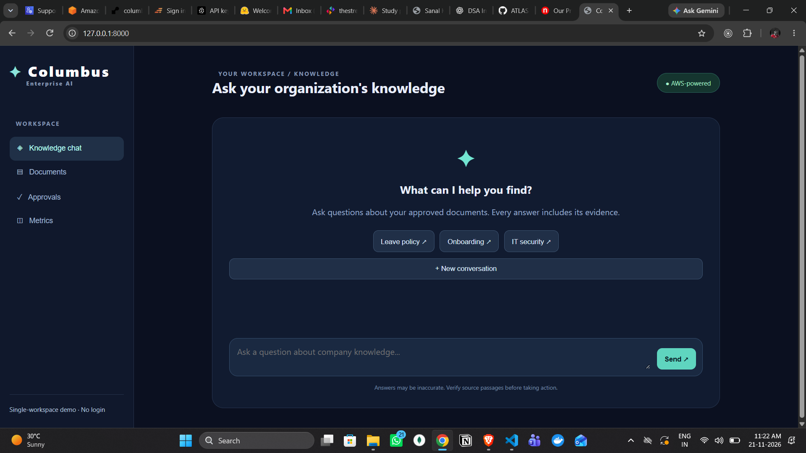

# Info-rag-system
This repo contains the code base for a production level rag system 

<!-- create the virtual environment  -->

** uv venv **
<!-- then activate the venv using the script -->
** .\.venv\Scripts\Activate.ps1  => for windows **

** install the packages from requirement.txt ** 

## uv pip install -r requirement.txt


## AWS SETUP
- Create an IAM user with programmatic access and give full access


## Pinecone Setup
- Create a free account on pinecone.io

## Gemini API model testing

Bedrock remains the default provider. To test with Google's free Gemini API
allowance, create an API key in
[Google AI Studio](https://aistudio.google.com/apikey). Then set these values in
`.env`:

```dotenv
MODEL_PROVIDER=gemini
GOOGLE_API_KEY=your_google_ai_studio_api_key
```

The defaults use `gemini-3.5-flash-lite` for chat and `gemini-embedding-001`
for embeddings. Google’s free tier has usage limits that may change; review the
[Gemini API pricing](https://ai.google.dev/gemini-api/docs/pricing). Embedding
vectors are stored in a separate Pinecone namespace from Bedrock vectors. Set
`MODEL_PROVIDER=bedrock` to switch back after enabling Bedrock access. Restart
the app after changing the provider.

This switches only chat and embeddings. PostgreSQL, S3 uploads, and Pinecone still
need their existing configuration. Existing Bedrock-indexed documents must be
uploaded/ingested again to search them with Gemini embeddings. Google’s free API
tier may use submitted content to improve its products, so test with non-sensitive
documents. Scanned PDFs use Gemini OCR when Gemini is selected; with Bedrock,
OCR must be performed before upload.

## setup vscode tool/extentsion for postgres


## Final UI
